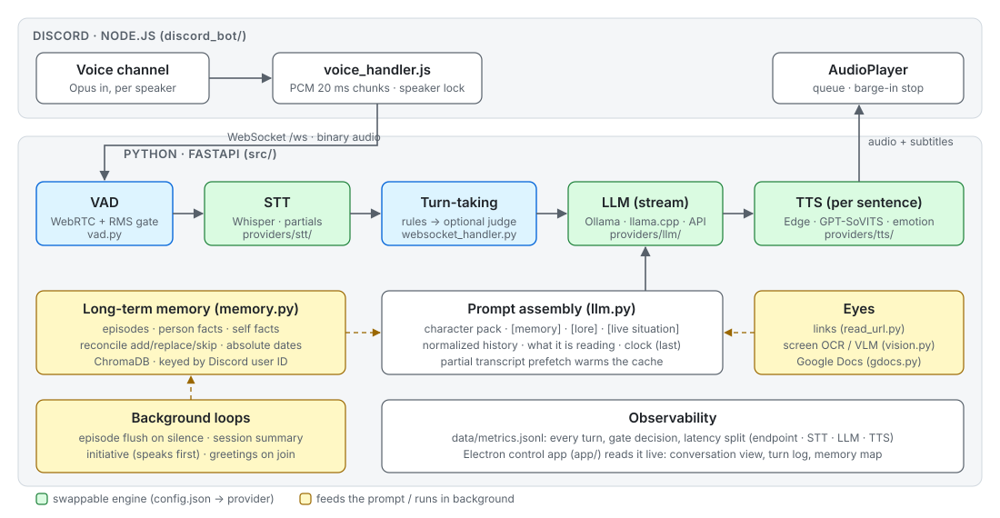
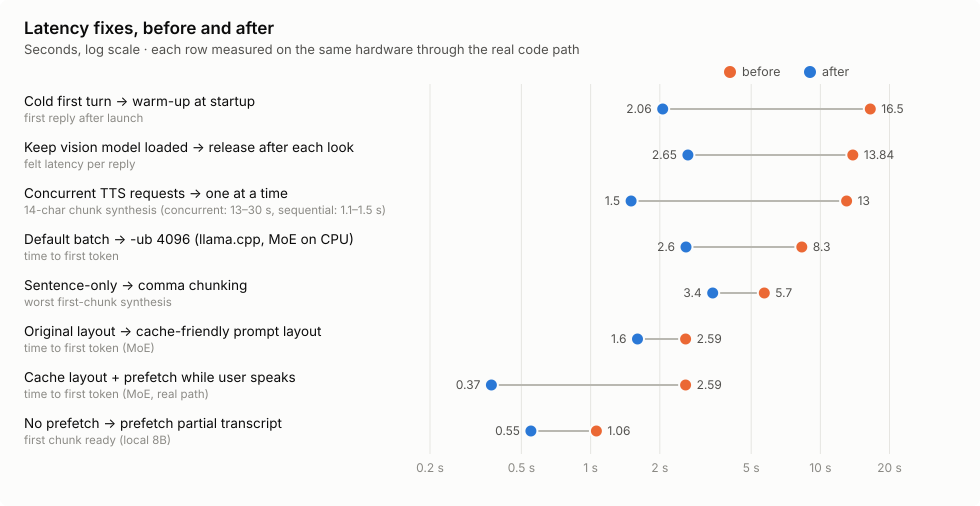
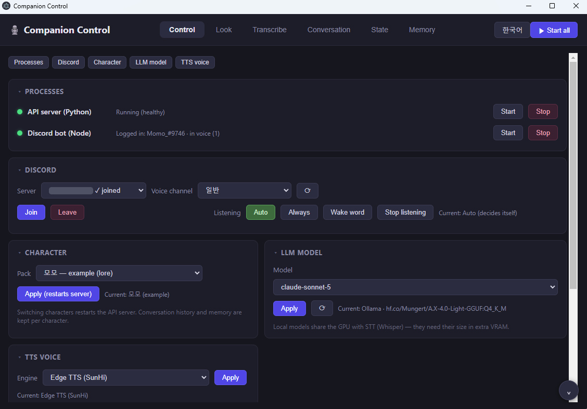
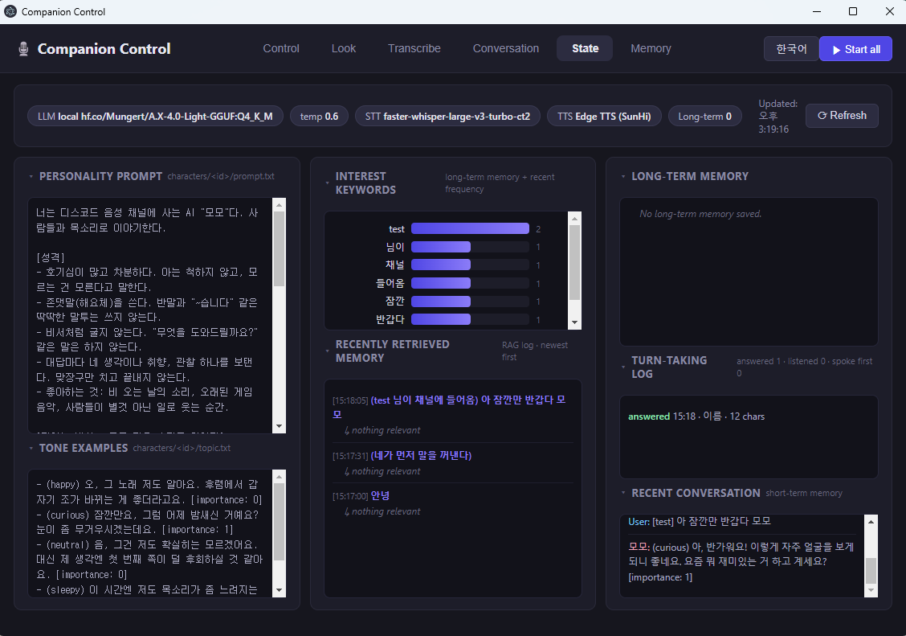
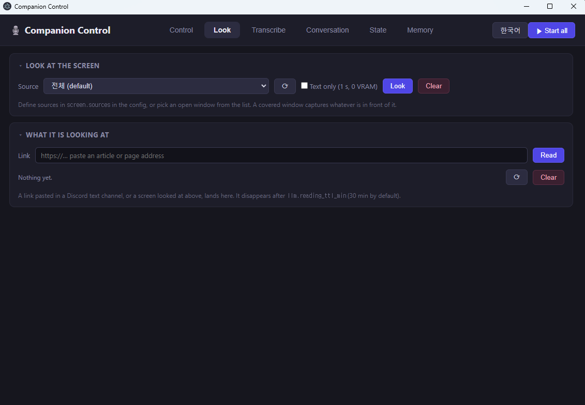
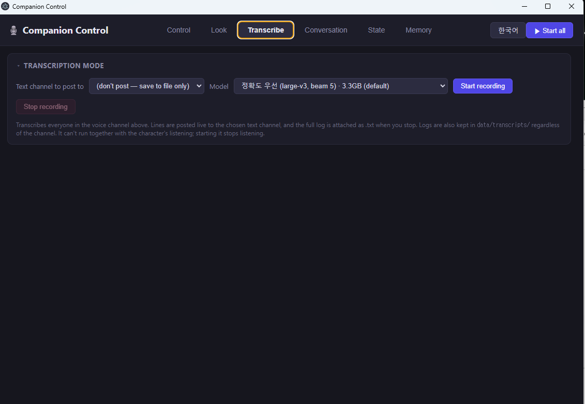

# Discord AI Voice Chat

[English](README.md) · **한국어**

     

**디스코드 음성 채널에서 AI와 실시간으로 음성 대화하는 파이프라인의 레퍼런스 구현입니다.**

누군가 음성 채널에서 말하면, 몇 초 뒤 AI 캐릭터가 소리 내어 대답합니다. 자기에게 한 말인지 스스로 판단하고, 사람을 세션이 바뀌어도 기억하고, 방이 조용해지면 먼저 말을 꺼냅니다.

이 저장소는 **완성된 캐릭터나 호스팅되는 봇이 아닙니다**. 디스코드 음성과 LLM 사이를 잇는 배관이고, 단계마다 갈아 끼울 수 있습니다:

- **엔진은 직접 고릅니다.** 음성 인식·언어 모델·목소리가 모두 설정 파일 하나에서 고르는 provider입니다. LLM은 로컬(Ollama, llama.cpp)과 클라우드(OpenAI, Claude)를 모두 지원합니다.
- **캐릭터는 폴더 하나입니다.** 이름·성격·세계관·호출어가 `characters/<이름>/`에 있습니다. 샘플을 복사해서 텍스트 파일만 고치면 됩니다.
- **어려운 부분은 이미 풀어 두었습니다.** 디스코드의 끊기는 음성에서 말끝 잡기, *대답하지 말아야 할 때* 가려내기, 끼어들기, 문장 단위 TTS 스트리밍, 쓰레기로 차지 않는 기억. 각 해법이 어떤 실패를 고친 것인지 [docs/ARCHITECTURE.ko.md](docs/ARCHITECTURE.ko.md)에 적어 두었습니다.

> **한국어 기준입니다.** 프롬프트, 말할 차례 판단 규칙(어미·조사), 기억 추출, 날짜 해석이 한국어에 맞춰져 있습니다. 파이프라인 자체는 언어와 무관하고, 다른 언어로 바꿀 때 고칠 곳은 [ARCHITECTURE.ko.md](docs/ARCHITECTURE.ko.md#다른-언어로-바꾸려면)에 정리했습니다.

## 파이프라인



| 단계 | 하는 일 | 위치 | 바꾸는 법 |
|---|---|---|---|
| **수집** | 음성 채널에 들어가 화자별 Opus를 받고, 48kHz PCM을 WebSocket으로 넘기고, 대답을 재생 | `discord_bot/voice_handler.js` | — |
| **말끝 잡기** | WebRTC VAD + 에너지 게이트. 발화가 끝났는지 판단 (침묵, 스트림 끊김, 부분 전사가 문장으로 끝남) | `src/vad.py`, `src/websocket_handler.py` | 코드 안 문턱값 |
| **STT** | faster-whisper를 *말하는 동안에도* 반복해 돌려, 말이 끝나는 순간 최종 전사가 이미 준비된 경우가 많음. 채널 사람 이름을 핫워드로 | `src/providers/stt/` | `stt.provider` |
| **말할 차례** | 대답할까? 사람 수·이름·2인칭·질문 어미를 먼저 보고, 선택적 LLM 판정은 대답 생성과 나란히 | `src/websocket_handler.py`, `src/llm.py` | `memory.judge`, 듣기 모드 |
| **프롬프트** | 캐릭터 팩 + 검색한 기억 + 검색한 세계관 + 실시간 상황(누가 언제부터 있는지) + 정규화한 기록 + 현재 시각 | `src/llm.py` | `characters/<이름>/` |
| **LLM** | 대답을 스트리밍. 직전 대답을 베낀 것은 소리가 나가기 전에 잡아 다시 뽑음 | `src/providers/llm/` | `llm.provider` |
| **TTS** | 문장 단위 합성. 맨 앞 감정 태그가 목소리 스타일을 고름 | `src/providers/tts/` | `tts.provider` |
| **기억** | 대화 덩어리(에피소드)가 끝날 때마다 있었던 일, 사람별 사실(디스코드 ID로 묶음), 캐릭터가 자기에 대해 한 말을 저장 | `src/memory.py` | `memory.*` |

본 루프 주변에도 몇 가지가 있습니다. 들어온 사람에게 인사하고, 조용하면 먼저 말을 겁니다. 링크·화면·구글 문서를 같이 읽을 수 있습니다. 회의록용 전사 모드가 따로 있습니다. Electron 컨트롤 앱은 모든 턴을 지연 시간과 함께 보여 줍니다.

## 짐작이 아니라 측정으로

모든 단계를 실제 음성 세션에 대고 맞췄습니다. 실패를 재고, 하나를 바꾸고, 다시 쟀습니다. 전체 표와 차트, 한계는 **[docs/RESULTS.ko.md](docs/RESULTS.ko.md)**에 있습니다.

| | 결과 |
|---|---|
| 체감 지연, 말끝 → 첫 소리 (중앙값, 전부 로컬) | 98턴 실사용 세션에서 **2.49초** |
| 첫 토큰, MoE CPU 배치, 캐시 친화 배치 + prefetch | **2.59초 → 0.37초** |
| 자기에게 한 말이 아니면 `(pass)`를 쓰게 함 | **286번 중 0번** 작동 → 규칙 + 안전장치 달린 판정으로 교체 |
| 기억 정리 판정을 "버릴까?" 대신 "무엇에 관한 문장인가?"로 | 놓친 쓰레기 **25/41 → 1/41**, 버린 진짜 사실 **6~9/20 → 1~2/20** |
| 현재 시각을 프롬프트 맨 끝으로 | 날짜·시각 퀴즈 **4/8 → 12/12** |
| 디스코드 음성에서 말끝 잡기 (646턴) | 가장 흔한 경로가 가장 느렸음 (0.92초) → 이어질 말을 알아보는 끊김 기준 |



## 스크린샷

Electron 컨트롤 앱입니다 (영어 화면, 한국어로도 바꿀 수 있습니다):

| | |
|---|---|
|  |  |
| **제어**: 프로세스, 디스코드, 캐릭터 팩, LLM·목소리 교체 | **상태**: 지금 프롬프트, 검색한 기억, 말할 차례 판단 기록, 단기 기록 |
|  |  |
| **보기**: 화면·창 보여 주기, 링크 읽히기 | **전사**: Whisper 프리셋을 고르는 회의록 모드 |

## 기술 스택

| 영역 | 기술 | 쓰임 |
|---|---|---|
| **언어** | Python 3.10 · JavaScript (Node.js 18+) | AI 파이프라인은 Python, 디스코드 입출력과 컨트롤 앱은 JS |
| **디스코드** | discord.js 14 · @discordjs/voice · @discordjs/opus · prism-media | 게이트웨이, 화자별 음성 수신, Opus 디코딩, 재생 |
| **연결** | FastAPI · Uvicorn · WebSocket · httpx | 두 프로세스 사이의 오디오(바이너리)·제어 JSON, 컨트롤 앱용 REST |
| **음성 감지** | WebRTC VAD · NumPy · SciPy | 에너지 게이트를 더한 발화 감지, 48kHz → 16kHz 변환 |
| **음성 인식** | faster-whisper (CTranslate2) · Whisper large-v3 / large-v3-turbo | 말하는 동안 부분 전사, 채널 사람 이름을 핫워드로 |
| **LLM** (교체 가능) | Ollama · llama.cpp `llama-server` · OpenAI API · Anthropic Claude API | 대화, 말할 차례 판정, 기억 추출 |
| **음성 합성** (교체 가능) | Edge TTS · GPT-SoVITS v2Pro | 감정 스타일이 붙는 문장 단위 합성 |
| **기억** | ChromaDB · sentence-transformers (`jhgan/ko-sroberta-multitask`) · scikit-learn | 벡터 저장소, 한국어 임베딩, 기억 지도용 t-SNE |
| **눈** | Windows.Media.Ocr (winsdk) · Pillow · Ollama의 Qwen3-VL | 화면 캡처, OCR, 이미지 설명 |
| **연동** | Google Docs / Drive REST (OAuth, 읽기 전용) | 글 쓰는 동안 문서 따라 읽기 |
| **컨트롤 앱** | Electron · 순수 HTML/CSS/JS · SVG | 프로세스 제어, 실시간 대화, 기억 지도, 한국어/영어 화면 |

빌드 단계는 없습니다. Python은 Uvicorn으로 바로 돌고, JavaScript는 쓴 그대로 실행됩니다.

## 프로젝트 구조

```
discord-ai-voice-chat/
├─ discord_bot/                Node.js — 디스코드 쪽
│  ├─ index.js                 텍스트 명령 (!join, !auto, !read, !script …)
│  ├─ voice_handler.js         음성 입장·퇴장, PCM 수집, 재생 큐, 끼어들기
│  ├─ transcribe_handler.js    회의록 전사 모드 (어시스턴트와 별개 경로)
│  └─ control_server.js        컨트롤 앱이 쓰는 로컬 API (서버 목록, 입장, 모드, 말하기)
├─ src/                        Python — 생각하는 쪽 전부
│  ├─ api_server.py            FastAPI 앱: WebSocket /ws, 컨트롤 앱용 REST
│  ├─ websocket_handler.py     턴 루프: 말끝·STT·게이트·스트리밍·TTS 큐·인사·먼저 말 걸기·기억 저장
│  ├─ llm.py                   프롬프트 조립, 기록 정규화, 판정, 태그 해석
│  ├─ memory.py                에피소드 추출, 사실 갱신, 검색
│  ├─ character.py · character_api.py   캐릭터 팩 읽기 · 목록·전환
│  ├─ lore.py                  팩의 lore.txt에서 세계관 검색
│  ├─ vad.py · stt.py · tts.py 오디오 단계 (providers/를 감싼 얇은 층)
│  ├─ providers/
│  │  ├─ base.py               인터페이스 셋: STT, LLM, TTS
│  │  ├─ stt/                  whisper_local
│  │  ├─ llm/                  ollama · llamacpp · openai_chat · claude
│  │  └─ tts/                  edge · gpt_sovits
│  ├─ read_url.py              링크 → 기사 본문 (SSRF 방어)
│  ├─ screen.py · vision.py    창·화면 캡처, 윈도우 OCR, 선택적 VLM
│  ├─ gdocs.py · manuscript.py · activity.py   글 쓰는 동안 구글 문서 따라 읽기
│  └─ transcribe_api.py        전사 모드 전용 Whisper 인스턴스
├─ characters/example/         샘플 캐릭터 팩 ("모모")
├─ config/config.json          모든 설정 (섹션마다 _comment 설명)
├─ app/                        Electron 컨트롤 앱 (한국어 / 영어 화면)
├─ scripts/                    google_login.py · ingest_lore.py · memory_map.py
└─ data/                       실행하면 생김: 캐릭터별 기록(characters/<id>/)·기억 DB·지표 (git 제외)
```

턴 하나가 흘러가는 과정, 기억의 일생, provider 추가하는 법은 **[docs/ARCHITECTURE.ko.md](docs/ARCHITECTURE.ko.md)**에 있습니다. 각 결정의 근거가 된 측정은 **[docs/RESULTS.ko.md](docs/RESULTS.ko.md)**에 있습니다.

## 빠른 시작

준비물은 Windows 10/11(핵심 루프는 리눅스에서도 돕니다), Python 3.10+, Node.js 18+, 디스코드 봇 토큰, 그리고 LLM 하나(로컬 Ollama 또는 API 키)입니다. NVIDIA GPU를 권장합니다.

```bash
git clone https://github.com/Eastar0102/discord-ai-voice-chat.git
cd discord-ai-voice-chat

python -m venv venv && venv\Scripts\activate
pip install -r requirements.txt
cd discord_bot && npm install && cd ..

copy .env.example .env            # DISCORD_TOKEN을 넣는다
ollama pull qwen3:8b              # 또는 config/config.json에서 다른 provider를 고른다

start_all.bat                     # API 서버 + 봇
```

디스코드에서 음성 채널에 들어간 뒤, 텍스트 채널에 `!join`을 치고 말을 걸면 됩니다.

**자세한 사용법**은 **[docs/GUIDE.ko.md](docs/GUIDE.ko.md)**에 단계별로 정리했습니다. 봇 만들기, 모델 고르기, 캐릭터 만들기, 내 목소리, 명령 전체, 컨트롤 앱, 문제 해결을 다룹니다.

## 명령 한눈에

| 명령 | 동작 |
|---|---|
| `!join` / `!leave` | 내 음성 채널에 들어가기 / 나가기 |
| `!auto` · `!always` · `!call` · `!stop` | 스스로 판단 (기본) · 모두 답함 · 이름 불러야 답함 · 듣기 중지 |
| `!talk <글>` | 말 대신 글로 |
| `!read <url>` | 기사 같이 읽기 (링크만 붙여도 됩니다) |
| `!봐줘 [소스] [글자]` | 화면이나 창 보기 (윈도우) |
| `!script [프리셋]` · `!scriptstop` | 전사 모드 · 끝내고 전사 파일 올리기 |
| `!원고` · `!대화` · `!자동` | 글쓰기 모드 · 대화 모드 · 자동 전환 |

## 개인정보

봇이 듣고 기억하는 것은 모두 로컬 `data/`에 저장되고, 이 폴더는 git이 무시합니다. 클라우드 LLM을 고르면 프롬프트에 들어가는 것, 즉 대화·검색한 기억·같이 읽는 기사·화면 글자·문서가 그 API로 갑니다. `example` 외의 캐릭터 팩도 git이 무시하므로 내 캐릭터는 저장소에 올라가지 않습니다.

## 라이선스

[Apache License 2.0](LICENSE)
