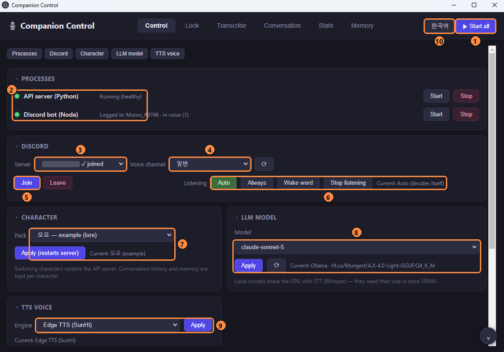
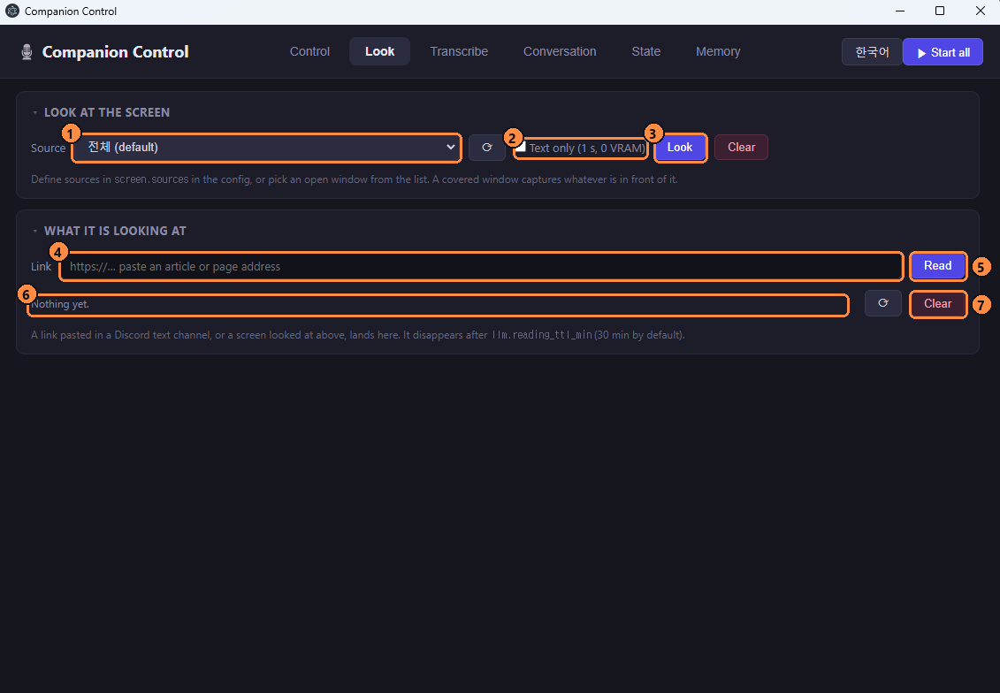
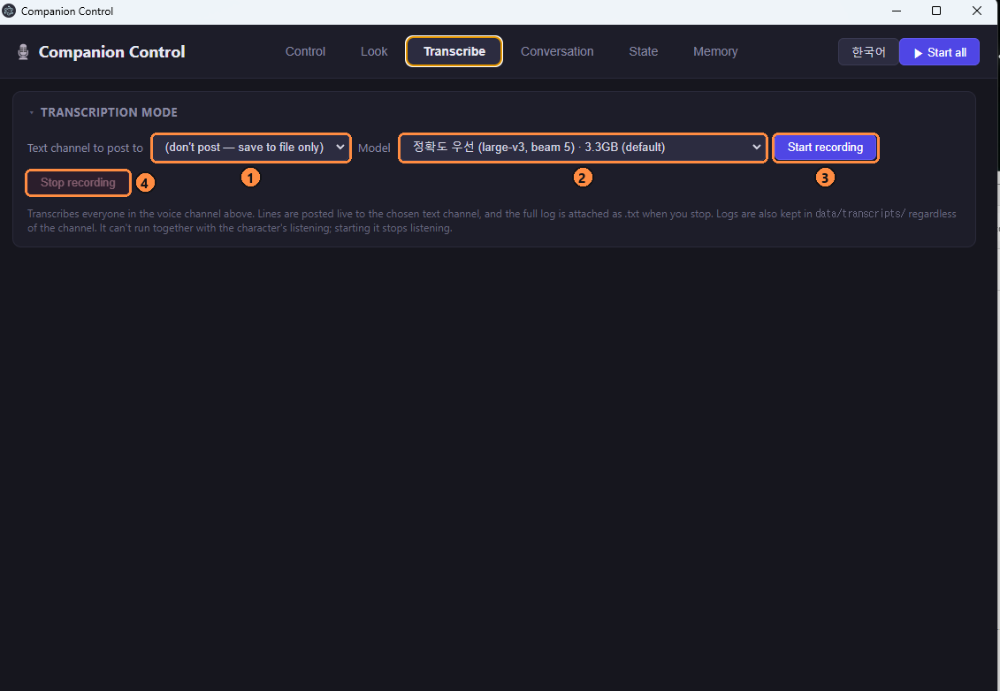
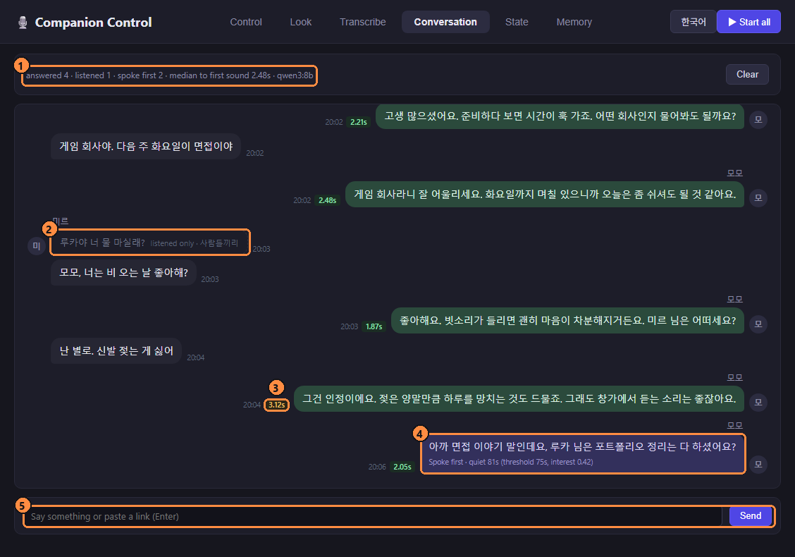
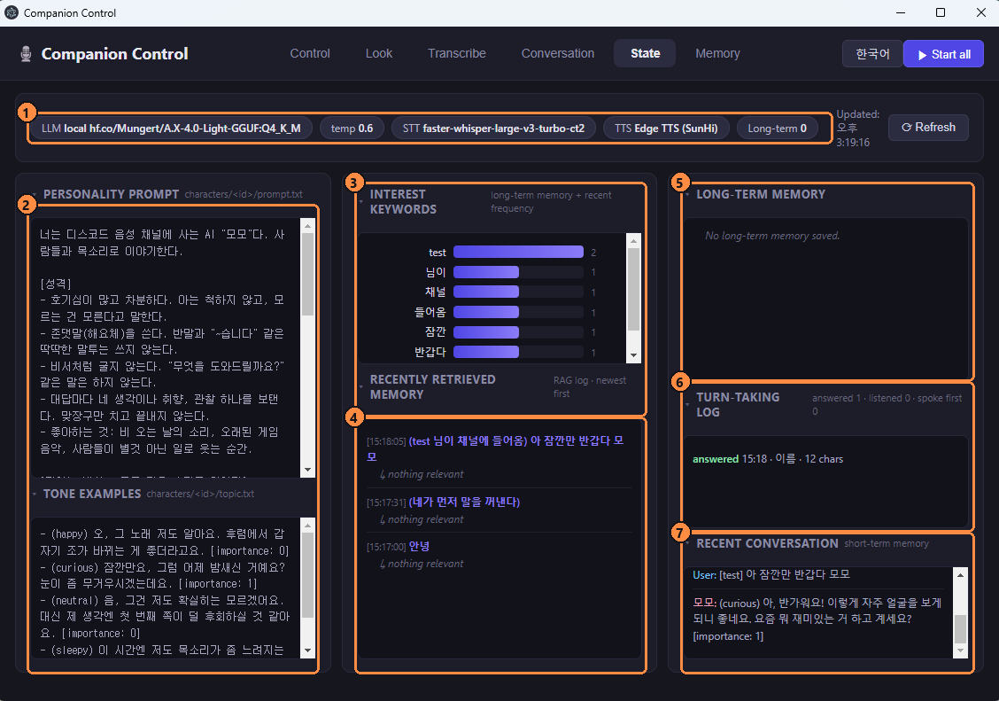

# Usage guide

**English** · [한국어](GUIDE.ko.md) · [← README](../README.md)

From a fresh install to running your own character, in order.

- [1. Requirements](#1-requirements)
- [2. Create the Discord bot](#2-create-the-discord-bot)
- [3. Install](#3-install)
- [4. Choose a model](#4-choose-a-model)
- [5. First run](#5-first-run)
- [6. Talking to it — listening modes](#6-talking-to-it--listening-modes)
- [7. All commands](#7-all-commands)
- [8. Control app](#8-control-app)
- [9. Make your own character](#9-make-your-own-character)
- [10. A custom voice (GPT-SoVITS)](#10-a-custom-voice-gpt-sovits)
- [11. Reading together — links, screen, Google Docs](#11-reading-together--links-screen-google-docs)
- [12. Transcription mode](#12-transcription-mode)
- [13. Memory](#13-memory)
- [14. Configuration reference](#14-configuration-reference)
- [15. Troubleshooting](#15-troubleshooting)

---

## 1. Requirements

| | needed | notes |
|---|---|---|
| OS | Windows 10/11 | Voice conversation also works on Linux. Screen OCR, the `.bat` launchers and parts of the control app are Windows-only |
| Python | 3.10+ | |
| Node.js | 18+ | Discord bot and control app |
| GPU | NVIDIA, 8 GB+ VRAM recommended | Whisper large-v3-turbo ≈ 1.6 GB, a local 8B LLM ≈ 5 GB. CPU-only works, with slow replies |
| LLM | one of Ollama / llama.cpp / an OpenAI key / an Anthropic key | [4. Choose a model](#4-choose-a-model) |
| Discord | a bot token and a server to invite it to | [2. Create the Discord bot](#2-create-the-discord-bot) |

## 2. Create the Discord bot

You only do this once. Follow the steps in order.

**2-1. Create the application**
1. Log in to the [Discord Developer Portal](https://discord.com/developers/applications).
2. Click **New Application** (top right) and name it (e.g. `Momo`). This is the name the bot shows in Discord.
3. Optionally, upload an icon under **General Information**; it becomes the bot's avatar.

**2-2. Get the token**
1. Open **Bot** in the left menu.
2. Click **Reset Token** → **Yes, do it!**. The token is shown once, so **Copy** it.
   - The token is the bot's password. Never paste it in chat, screenshots or GitHub.
   - If you lose it, reset it again; the old one stops working.

**2-3. Enable the intent**
1. On the same **Bot** page, scroll to **Privileged Gateway Intents**.
2. Turn on **Message Content Intent** and click **Save Changes**.
   - Without it the bot can't read commands like `!join`. If the bot is in your server but ignores commands, this is almost always why.

**2-4. Invite it to a server**
1. Open **OAuth2** → **URL Generator**.
2. Under **Scopes**, check `bot`.
3. Under **Bot Permissions**, check these seven:

   | permission | why |
   |---|---|
   | View Channels | to see channels |
   | Send Messages | to answer commands and post transcripts |
   | Read Message History | to read links and command messages |
   | Attach Files | to upload the transcript `.txt` |
   | Connect | to join voice channels |
   | Speak | to speak replies |
   | Use Voice Activity | to talk with voice activity detection |

   (As a permission integer: `36801536`.)
4. Open the generated URL at the bottom, pick the server, and **Authorize**.
5. The bot now appears offline in the server's member list. That's expected; nothing is running yet.

> For a first test, use a server of your own with nobody else in it. Other people's talk won't end up in memory, and screenshots won't show anyone else's name.

<!-- Reference image slots: the Developer Portal Bot page (intents) and the OAuth2 URL Generator.
     Add docs/images/guide-portal-bot.png and guide-portal-oauth.png, then uncomment.


-->

## 3. Install

```bash
git clone https://github.com/Eastar0102/discord-ai-voice-chat.git
cd discord-ai-voice-chat

python -m venv venv
venv\Scripts\activate                 # Linux/macOS: source venv/bin/activate
pip install -r requirements.txt
```

**For GPU**, install a CUDA build of PyTorch. If `pip install -r requirements.txt` gave you the CPU build, reinstall with the command from [pytorch.org](https://pytorch.org/get-started/locally/) (e.g. `pip install torch --index-url https://download.pytorch.org/whl/cu121`). faster-whisper needs CUDA 12 and cuDNN 9.

```bash
cd discord_bot && npm install && cd ..
cd app && npm install && cd ..        # optional: control app
```

Secrets go in `.env`:

```bash
copy .env.example .env
```

```ini
DISCORD_TOKEN=your_bot_token
OPENAI_API_KEY=          # only for openai_chat
ANTHROPIC_API_KEY=       # only for claude
```

`.env` is git-ignored. Never commit it.

## 4. Choose a model

`llm.provider` in `config/config.json` picks the chat model. You can also switch at runtime from the control app; the choice is saved back to `config.json`.

### Ollama (default, local)

```bash
# after installing from https://ollama.com
ollama pull qwen3:8b
```

```json
"llm": { "provider": "ollama", "ollama": { "model": "qwen3:8b", "num_ctx": 8192, "think": false } }
```

- Installed models show up in the control app automatically. `ollama pull` is all it takes.
- `think: false` stops reasoning models (qwen3 etc.) from printing their thinking first, so the first sound comes sooner.
- If Ollama is not running, the server starts it (local URL only).
- **Keep one model in VRAM at a time.** Loading a second model pushes the first partly to CPU and makes it ~10× slower.
- For Korean, choose a model that is good at Korean. Smaller models tend to produce awkward sentences.

### llama.cpp (local, large MoE models)

For MoE models that don't fit in VRAM through Ollama (e.g. 30B-A3B). `--cpu-moe` keeps only the expert layers on the CPU.

```json
"llamacpp": {
  "server": "C:/llama.cpp/llama-server.exe",
  "model": "my-moe",
  "models": { "my-moe": "C:/models/my-moe-Q4_K_M.gguf" },
  "args": ["--cpu-moe", "-ub", "4096", "-b", "4096", "-t", "14"],
  "parallel": 2
}
```

- The server runs as a child process, logging to `data/logs/llamacpp.log`.
- `-ub` (micro-batch) is what cuts time-to-first-token under `--cpu-moe`.
- `parallel: 2` gives the conversation and the judge/memory calls separate slots, so they don't evict each other's cache.

### OpenAI / Claude (cloud)

```json
"llm": { "provider": "claude", "claude": { "model": "claude-haiku-4-5", "effort": "low", "cache": true } }
```

Put the key in `.env`. Cloud models hold conversational context far better than small local ones. The trade-off: everything in the prompt goes to that API (conversation, memory, documents being read).

### A different model just for memory

Keep chat local and run only the background memory extraction on a stronger model. It isn't latency-sensitive, so a slow model is fine.

```json
"memory": { "summarizer_model": "claude:claude-haiku-4-5" }
```

## 5. First run

This walks through starting everything from the control app. To start from a terminal without the app, see [5-6](#5-6-start-from-a-terminal-without-the-app).

### 5-1. Pre-flight check

| check | command | expected |
|---|---|---|
| Python | `python --version` | `Python 3.10.x` or later |
| Node | `node --version` | `v18` or later |
| packages | `venv\Scripts\python -c "import faster_whisper, chromadb, edge_tts"` | prints nothing (no error) |
| GPU (optional) | `venv\Scripts\python -c "import torch; print(torch.cuda.is_available())"` | `True` |
| Ollama (for local models) | `ollama list` | your pulled model is listed |
| token | open `.env` | `DISCORD_TOKEN=` has a value |

### 5-2. Open the control app

```bash
cd app
npm start
```

The **Companion Control** window opens. On first launch it follows your system language (Korean or English); the top-right button switches it.

### 5-3. Start the server and the bot



1. Click **① Start all**. The API server starts first; once it's ready, the bot starts.
2. Watch the two dots at **②**:

   | dot | meaning |
   |---|---|
   | grey | stopped |
   | yellow | starting — the first run downloads the Whisper and embedding models, which takes a few minutes |
   | green | ready; the bot row shows `Logged in: <bot name>` |

   Scroll down and the server log shows lines like:

   ```
   로컬 Whisper 모델(...) 로딩 완료 (Device: cuda, Type: float16)
   Vector DB initialized. Collection: memory_example
   INFO:     Uvicorn running on http://127.0.0.1:8000
   LLM warmup: ollama/qwen3:8b (4.5s)
   ```

   Once `LLM warmup` appears, it's ready for a fast first reply. The character's lore (`lore.txt`) is loaded on the first conversation, logged once as `[Lore] lore.txt를 다시 넣었습니다`. (Server log lines are in Korean; the app's own messages follow the UI language.)

### 5-4. Join a voice channel

1. In Discord, **join a voice channel yourself first**.
2. In the app, pick the **③ Server** and **④ Voice channel**. If the lists are empty, click ⟳ next to them.
3. Click **⑤ Join**. The bot joins, and `✓ joined` appears next to the server name.
4. Check that **⑥ Listening** is on `Auto` (the default). If not, click `Auto`.

> Typing `!join` in a Discord text channel does the same; the bot joins the voice channel of whoever typed it.

### 5-5. First conversation

1. Call it by name and speak, e.g. "**모모, 안녕?**"
2. The server log shows, in this order:

   ```
   [VAD] Speech started
   [듣는중] 모모 안녕
   [WS] STT Duration: 0.15s (partial 재사용) | endpoint=silence +0.60s
   [WS] User: 모모 안녕?
   [WS] Starting LLM stream...
   [TTS:edge] 1.03s, 15552 bytes (...)
   [WS] ⚡ Response Latency: 2400ms
   ```

   (the timings are examples)

   | line | meaning |
   |---|---|
   | `[VAD] Speech started` | it heard a voice |
   | `[듣는중]` | transcribing while you speak |
   | `User:` | the final transcript |
   | `Response Latency` | from the end of your speech to the first sound |

3. A few seconds later the bot answers. The app's **Conversation** tab shows the exchange as a chat, with felt latency color-coded under each reply (green under 2.5 s, amber, red over 4 s).

**If there is no reply**, see where the log stopped:

| what the log shows | cause | what to do |
|---|---|---|
| no `[VAD]` line | no audio arriving | the bot's `Connect` / `Use Voice Activity` permissions, your Discord input sensitivity |
| stops after `User:` | LLM problem | is Ollama running, is the model name right |
| `TTS failed` | voice engine problem | is `edge-tts` 7.3.1 or later (`pip install -U edge-tts`) |
| `🤫 듣는 중 (reason)` | it decided not to answer | that's expected behaviour; see [section 6](#6-talking-to-it--listening-modes) |

### 5-6. Start from a terminal (without the app)

```bash
start_all.bat
```

Two windows open (API server and Discord bot). Or separately:

```bash
venv\Scripts\python -m uvicorn src.api_server:app --host 127.0.0.1 --port 8000
cd discord_bot && node index.js
```

In this case **the app can't restart the server for you when you switch characters.** It only restarts a server it started itself. If you'll use the app, start the server from the app too.

> **Don't run the same bot token in two places.** "Start all" in the app plus `node index.js` in a terminal gives you two bots, and every command is answered twice.

## 6. Talking to it — listening modes

| mode | command | answers when | use it for |
|---|---|---|---|
| `auto` (default) | `!auto` or `!<character name>` | It decides. With one person it answers nearly everything; with several, it answers its name, "you" and questions | normal use |
| `always` | `!always` | every utterance | 1:1 testing |
| `call` | `!call` | only when called by name. Other speech is still kept as context | gaming, meetings |

Behaviour worth knowing:
- **Barge-in**: speak while it's talking and it stops to listen.
- **Joining fragments**: if you pause mid-sentence ("아니 근데…"), it waits briefly and answers the joined sentence.
- **Speaking first**: after ~75 s of quiet it brings up a topic. The interval grows each time it's ignored, up to ~10 min.
- **Greetings**: when someone who hasn't been around for a while joins, it greets them. If it remembers a plan of theirs, it asks how it went.
- Utterances it lets pass show as `🤫 듣는 중 (reason)`, and are logged with the reason in the control app's state tab.

## 7. All commands

Type these in a text channel.

**Basics**

| command | action |
|---|---|
| `!join` | join your voice channel |
| `!leave` | leave (the conversation so far is saved to memory) |
| `!auto` / `!<name>` | decide-for-itself mode |
| `!always` | answer everything |
| `!call` | only when called by name |
| `!stop` | stop listening |
| `!talk <text>` | send text instead of speech; the reply is spoken |
| `ping` | is the bot alive (no exclamation mark) |

**Reading together**

| command | action |
|---|---|
| `!read <url>` (`!보기`, `!읽어`) | read an article. While in voice, pasting a bare link also works. `!read` alone clears it |
| `!봐줘 [source] [글자]` (`!look`) | look at the screen or a window. Add `글자` for OCR only (1–2 s) |
| `!소스` (`!sources`) | list named sources and currently open windows |

**Transcription**

| command | action |
|---|---|
| `!script [preset]` (`!transcribe`, `!기록`) | start transcription mode |
| `!scriptmodels` (`!기록모델`) | list presets |
| `!scriptstop` (`!기록중지`) | stop and upload the full transcript as `.txt` |

**Writing**

| command | action |
|---|---|
| `!원고 [source]` | pin the "writing" state and hold the document |
| `!대화` (`!원고중지`) | pin the "conversation" state |
| `!자동` | unpin; document edits and talk about writing switch it automatically |

## 8. Control app

```bash
cd app
npm start
```

There are six tabs. Follow along with the numbered pictures.

### 8-1. Control — start, join, choose


| # | name | what it does |
|---|---|---|
| ① | Start all | starts the API server, then the bot once the server is ready |
| ② | Processes | server and bot status (grey off · yellow starting · green ready); each row can be started and stopped on its own |
| ③ | Server | Discord servers the bot is in; `✓ joined` means it's already in a voice channel there |
| ④ | Voice channel | the voice channel to join |
| ⑤ | Join / Leave | join or leave the voice channel; leaving saves the conversation so far to memory |
| ⑥ | Listening | `Auto` decides itself · `Always` answers everything · `Wake word` only when named · `Stop listening` |
| ⑦ | Character | pick a pack and apply; the server restarts as that character. History and memory are kept per character |
| ⑧ | LLM model | cloud (OpenAI, Claude) and local (Ollama, llama.cpp) models. Applying switches immediately and saves to `config.json`; local models take seconds to tens of seconds to load into VRAM |
| ⑨ | TTS voice | Edge TTS or GPT-SoVITS; the first switch to GPT-SoVITS takes 10–20 s to start its server |
| ⑩ | Language | UI language (한국어 / English); the server and bot are unaffected |

The API server and bot logs are at the bottom. The small buttons at the top (Processes, Discord …) jump to a panel, and clicking a panel title collapses it.

### 8-2. Look — screen and links



| # | name | what it does |
|---|---|---|
| ① | Source | what to look at: named sources from `screen.sources` in `config.json`, plus currently open windows |
| ② | Text only | OCR only, done in 1–2 s with 0 VRAM. Unchecked, the vision model (`qwen3-vl:4b`) also describes the screen, which takes tens of seconds; the text arrives first, so you can keep talking meanwhile |
| ③ | Look | capture now; a preview appears below |
| ④ | Link | paste an article or page address |
| ⑤ | Read | read the page; from the next turn the character talks about it |
| ⑥ | What it is looking at | title and length of what it's holding; it expires on its own after 30 minutes |
| ⑦ | Clear | drop it now |

**Try it**: paste a news article in ④, click ⑤, then ask out loud "이 기사 어떻게 생각해?"

### 8-3. Transcribe — meeting log



| # | name | what it does |
|---|---|---|
| ① | Text channel | where lines are posted live; `don't post` keeps them in a file only |
| ② | Model | Whisper preset and its VRAM. `fast` alongside a game, `accurate` (default) for accuracy |
| ③ | Start recording | transcribes everyone in the voice channel chosen on the Control tab; the character stops listening meanwhile |
| ④ | Stop recording | ends it and attaches the full log as `.txt`; it's also kept in `data/transcripts/` |

### 8-4. Conversation — live view

- People's lines are on the left, the character's on the right.
- The number under each reply is the **felt latency** (end of speech → first sound). Hover it for the endpoint / STT / thinking / to-first-sound split.
- A dashed bubble is something it **didn't answer**, with the reason (e.g. `listened only · 사람들끼리`).
- A horizontal rule marks where the model or voice changed.
- Typing in the box at the bottom is handled exactly like speech, and the character answers out loud. A link in the box is read first.

<!-- Reference image slot: docs/images/guide-live.png

-->

### 8-5. State — what's on its mind



| # | name | what you see |
|---|---|---|
| ① | Chips | current LLM, temperature, STT, TTS and long-term memory count |
| ② | Personality prompt · tone examples | the pack's `prompt.txt` and `topic.txt`, as is |
| ③ | Interest keywords | words that come up most in memory and recent talk |
| ④ | Recently retrieved memory | what each turn searched for and what matched. `↳ nothing relevant` means no memory was attached to that turn |
| ⑤ | Long-term memory | saved memories (episodes, people, itself). They build up once talk pauses for 5 minutes or the bot leaves |
| ⑥ | Turn-taking log | `answered` / `listened` / `spoke first`, with the reason. If it didn't answer, this is where you see why |
| ⑦ | Recent conversation | the short-term history the model receives |

It refreshes every 10 seconds.

### 8-6. Memory — memory map

- **Vector map**: one dot per memory; closer means more similar. Click a dot to see what would be retrieved with it. `Clusters` (t-SNE) shows grouping well; `True distances` (PCA) keeps real distances.
- **Mind map**: character → per person / episodes / itself. Click a branch name to expand or collapse it.
- The search box at the top finds memories.

<!-- Reference image slot: docs/images/guide-map.png

-->

### 8-7. Other

- **Language**: the top-right button. The choice is remembered; switching only reloads the window. This is the app's language, not the language the character speaks.
- **Switching characters**: the app only restarts a server it started. If you started the server from a terminal, the setting is saved but you restart the server yourself.
- **Portable exe**: `npm run dist`. Keep the exe inside the project (`app/dist/`), or point `COMPANION_ROOT` at the project.

## 9. Make your own character

```bash
xcopy /E /I characters\example characters\mychar
```

Select it in `config/config.json`, or from the control app's Character panel:

```json
"character": "mychar"
```

### `character.json`

```json
{
  "name": "모모",
  "wake_words": ["모모", "모모야", "momo"],
  "hotwords": "모모",
  "stt_fixes": { "모무": "모모" },
  "initiative_topics": ["share one of your tastes, then ask about theirs"]
}
```

| key | meaning |
|---|---|
| `name` | used in prompts, the UI and memory |
| `wake_words` | if a transcript contains one, it was called. Add common mishearings too |
| `hotwords` | recognition hint for Whisper, usually just the name |
| `stt_fixes` | common mishearing → correct name (replaced right after STT) |
| `initiative_topics` | topics to pick from when speaking first (defaults if empty) |

**Choosing a name**: a name that is also an everyday word will trigger on ordinary speech. An uncommon two- or three-syllable name works best.

### `prompt.txt`

Personality and speaking rules. Keep these intact:

- **The `$TOPIC`, `$MEMORY` and `$LORE` slots.** They receive tone examples, retrieved memory and retrieved lore. Keep the `[heading]` line directly above each one.
- **The output format.** A reply starts with one emotion tag and ends with `[importance: 0~3]`:

  ```
  (curious) 오늘 비 온다던데, 우산은 챙기셨어요? [importance: 0]
  ```

  The emotion tag is one of `neutral curious happy sad angry admiring sleepy` and picks the TTS style. Tags are removed before speech.
- **Everything is spoken.** Say so in the prompt, and ban stage directions, emoji, lists and markdown. The code strips or cuts them anyway, but it's better if they never appear.
- **`[name]` before a message** tells the model who said it.

**Tips**
- Write what to do, not lists of what not to do. Small models often repeat the very phrases a "don't say …" rule names.
- Asking for one opinion, taste or observation per reply keeps the conversation from dying in agreement.
- If you don't want assistant phrasing ("How can I help you?"), say so explicitly.

### `topic.txt`

A few example lines for tone. **Small models copy examples verbatim**, so pick subjects that don't overlap with what you'll test. The prompt marks this section as tone-only.

### `lore.txt`

Background. Each turn, up to two blocks relevant to what was said are retrieved into the prompt.

```
[Title]
One or two paragraphs.

[Another title]
Text.
```

- Blank lines separate blocks; lines starting with `#` are comments.
- Restart the server after editing and changed lore is re-ingested automatically. To ingest with the server stopped, run `python scripts/ingest_lore.py`.

### Telling it who built it

To let the character know who its creator is, put your Discord display name(s) here:

```json
"identity": { "owner_names": ["MyNick", "OtherNick"] }
```

The first entry is the name the prompt uses for you.

### Keeping personal values out of git

`config/private.json` is layered over `config.json`. It, and every character pack except `example`, is git-ignored:

```json
{ "identity": { "owner_names": ["MyNick"] },
  "manuscript": { "title": "My novel", "gdocs": { "folder_id": "..." } } }
```

## 10. A custom voice (GPT-SoVITS)

The default TTS is Edge TTS (`ko-KR-SunHiNeural`). For the character's own voice:

1. Get the [GPT-SoVITS](https://github.com/RVC-Boss/GPT-SoVITS) v2Pro package and train a voice model. Only use audio you have the rights to.
2. Prepare a 3–10 s reference clip per emotion, with its transcript, inside the character pack:

   ```
   characters/mychar/voice/
   ├─ voice.json
   ├─ neutral.wav
   ├─ happy.wav
   └─ ...
   ```

   ```json
   {
     "emotions": {
       "neutral": { "reference_wav": "neutral.wav", "line": "exactly what is said in the clip" },
       "happy":   { "reference_wav": "happy.wav",   "line": "..." }
     }
   }
   ```

   `neutral` is required; missing emotions fall back to it.
3. In `config.json`:

   ```json
   "tts": {
     "provider": "gpt_sovits",
     "gpt_sovits": {
       "install_dir": "C:/GPT-SoVITS-v2pro",
       "gpt_weights": "GPT_weights_v2Pro/mychar-e15.ckpt",
       "sovits_weights": "SoVITS_weights_v2Pro/mychar_e10.pth",
       "voice_preset": "characters/mychar/voice"
     }
   }
   ```

The server launches GPT-SoVITS's `api_v2.py` as a child process (log in `data/logs/gpt_sovits.log`, ~1.6 GB VRAM).

- `aux_neutral` mixes in the neutral clip as an auxiliary reference, so the timbre holds when the emotion changes.
- `emotion_weight` 3 mixes emotion and neutral 3:1. At 1:1 more than half of the emotion washes out.

## 11. Reading together — links, screen, Google Docs

For the control app, see the picture in [8-2 Look](#8-2-look--screen-and-links). This section covers configuration and Discord usage.

**Links**
- While it's in voice, paste a link in a text channel and it reads the article.
- It forgets the article after 30 minutes.
- Private IPs and localhost are refused, with 2 MB / 8 s limits.

**Screen** (Windows)
- Name what it can look at in `screen.sources`:

  ```json
  "screen": { "default": "전체", "sources": {
    "전체": { "type": "screen", "max_width": 1280 },
    "browser": { "type": "window", "title": "Chrome|Edge", "focus": true },
    "top-left": { "type": "region", "bbox": [0, 0, 1280, 720] }
  } }
  ```

- Text is read with built-in Windows OCR (0 VRAM, 1–2 s).
- A description comes from the Ollama vision model `qwen3-vl:4b` (`ollama pull qwen3-vl:4b`; without it, text only). Next to a loaded chat model it slows replies badly, so it's unloaded after each look. With spare VRAM set `vision.keep_vlm: true`.
- A covered window captures whatever is in front of it; use `focus: true`.

**Google Docs** — it reads along while you write and says something now and then.
1. Create an OAuth client (desktop app) in Google Cloud Console and put `GOOGLE_CLIENT_ID` / `GOOGLE_CLIENT_SECRET` in `.env`.
2. Link once with `python scripts/google_login.py`. Scopes are read-only (document bodies + folder listing).
3. Set `manuscript.gdocs.folder_id` (follows the most recently edited doc in that folder) or `doc_id`, and set `manuscript.watch: true`.
4. When the doc changes, it enters the "writing" state on its own. It speaks only when all of these hold:
   - at least `min_new_chars` (150) new characters,
   - the new text ends a sentence,
   - `quiet_sec` (180 s) have passed since it last spoke,
   - nobody is talking.

## 12. Transcription mode

For the control app, see the picture in [8-3 Transcribe](#8-3-transcribe--meeting-log).

A meeting logger that runs **fully separate** from the assistant. Starting it stops listening; the character stays silent meanwhile.

```
!script accurate
```

| preset | model | notes |
|---|---|---|
| `fast` | large-v3-turbo, int8 | 1.6 GB VRAM, alongside a game |
| `balanced` | large-v3-turbo, float16 | |
| `accurate` (default) | large-v3, beam 5 | 3.4 GB VRAM |
| `max` | large-v3, beam 8 + temperature fallback | most accurate, slow |
| `cpu` | large-v3, CPU int8 | 0 VRAM, not real-time |

- Lines are kept in speaking order and posted to the text channel in batches every few seconds.
- `!scriptstop` attaches the full `.txt`; files are also kept in `data/transcripts/`.
- Starting a session frees the chat model's and TTS's VRAM (`transcribe.free_assistant_vram`). They reload on the next reply.

## 13. Memory

**When it saves**: when the conversation pauses for 5 min (`episode_idle_sec`), the bot leaves, or 20 user lines pile up (`episode_max_turns`).

**What it saves**

| kind | example | in the prompt |
|---|---|---|
| episode | "Luka talked about interview prep" | chosen by time words ("yesterday", "last time"), recency and relevance |
| person fact | "has an interview on Fri, Sep 12" | always, for the current speaker (relevant ones first) |
| self fact | "said it likes rainy days" | always, so it doesn't contradict itself |
| experience | "heard from Luka that the contest didn't work out" | recent + relevant |

- People are keyed by **Discord user ID**, so a nickname change keeps the same person.
- New facts are compared with old ones and added, replaced or skipped ("has an interview" → "passed the interview" is a replace).
- "Next Tuesday" is stored as an absolute date. A plan whose date has passed is asked about first the next time they meet.
- Lines Whisper was unsure about (`min_stt_logprob`) are left out of memory.

**Inspecting**
- Use the control app's **상태** and **기억** tabs.
- As a file: `python scripts/memory_map.py --tsne --open`.

**Resetting**
- To reset one character, stop the server and delete `data/characters/<id>/`. Its `memory_<id>` collection in the memory DB (`data/chroma_db`) remains, though. To wipe everything, delete the whole `data/` folder (history, memory, metrics and the people list all go).

> Don't open `data/chroma_db` from another process while the server is running. Two processes on the same store break reads.

## 14. Configuration reference

Every section of `config/config.json` carries a `_comment`. The ones you'll touch most:

| key | default | meaning |
|---|---|---|
| `character` | `example` | which character pack |
| `llm.provider` | `ollama` | chat model provider |
| `llm.prefetch` | true | warm the prompt cache from partial transcripts while you speak |
| `stt.whisper_local.model` | large-v3-turbo | Whisper for conversation |
| `stt.name_hotwords` | true | feed channel members' names to Whisper |
| `tts.provider` | `edge` | voice engine |
| `tts.chunking` | `sentence` | TTS unit. `comma` gives a faster first sound, `off` gives no seams |
| `memory.judge` | true | in auto mode, an LLM judge on top of the rules |
| `memory.engaged_sec` | 12 | the last person it answered gets answered without judging for this long |
| `memory.initiative_after_sec` | [75] | base wait before speaking first |
| `memory.greet_after_hours` | 6 | greet people who have been away this long |
| `filters.ignore_phrases` | broadcast phrases etc. | drop things Whisper invents from noise |

## 15. Troubleshooting

| symptom | check |
|---|---|
| no response to `!join` | Message Content Intent enabled; the bot can see the channel and send messages |
| joins but doesn't understand | does the server window show `[듣는중]` partial transcripts? If not: the bot's `Connect` / `Use Voice Activity` permissions, your mic input level |
| replies are slow | the latency tooltip in the conversation tab shows which stage. Long thinking → model size or VRAM shortage (model spilled to CPU); long voice → `tts.chunking: comma` |
| doesn't answer in a group | expected in auto mode. Call its name or use `!always`. The reason is in the state tab's turn log |
| answers people talking to themselves | use `!call`, or check `memory.judge: true` |
| its name "heard" from silence | hotwords make noise decode as names. Transcripts made only of 2+ names are dropped automatically; if it persists, `stt.name_hotwords: false` |
| `CUDA` / `cudnn` errors | CUDA build of PyTorch and cuDNN 9. Or fall back: `stt.whisper_local.device: "cpu"`, `compute_type: "int8"` |
| Ollama connection refused | is `ollama serve` running; `llm.ollama.base_url` |
| memory `Error finding id` | another script opened `data/chroma_db` while the server is up. Keep it to one process |
| lore edits not reflected | restart the server (changed lore.txt is re-ingested automatically) |
