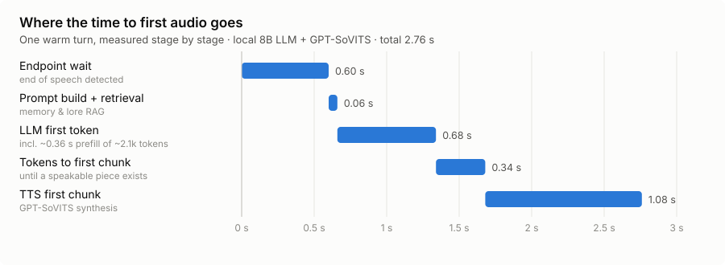
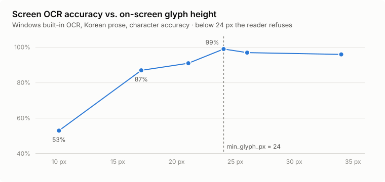

# Experiments and results

**English** · [한국어](RESULTS.ko.md) · [← README](../README.md)

Every design decision in this pipeline was made by measuring the failure first and the fix second, on real voice sessions. This page collects those numbers. For the reasoning behind each one, see [ARCHITECTURE.md](ARCHITECTURE.md#design-notes--easy-things-to-get-wrong).

**Setup.** One Windows PC with a 12 GB consumer NVIDIA GPU, everything local unless stated:
- STT: faster-whisper large-v3-turbo
- LLM: a 7B–8B model through Ollama
- TTS: GPT-SoVITS v2Pro

Measurements are from September–October 2026. See [Method and limits](#method-and-limits) for what these numbers can and can't support.

## At a glance

| | result |
|---|---|
| Felt latency (end of speech → first sound), median | **2.49 s** over a 98-turn live session, fully local |
| Time to first token with prefetch + cache-friendly layout (MoE on CPU) | **2.59 s → 0.37 s** |
| "Should I answer?" via an in-reply `(pass)` token | fired **0 / 286** times; replaced by rules + guarded judge |
| Memory screening asked "what is this about?" instead of "should I drop it?" | junk missed **25 / 41 → 1 / 41**, genuine facts dropped **6–9 / 20 → 1–2 / 20** |
| Putting the clock at the end of the prompt | date/time quiz **4 / 8 → 12 / 12** |
| Screen OCR at ≥24 px glyphs | **99 %** character accuracy (87 % at a default 16 px editor) |

---

## 1. Latency

### Where the time goes

| stage | seconds |
|---|---|
| Endpoint wait (deciding the speaker has finished) | 0.60 |
| Prompt build incl. memory + lore retrieval | 0.06 |
| LLM time to first token (incl. ~0.36 s prefill of ~2,100 tokens) | 0.68 |
| Tokens until the first speakable chunk | 0.34 |
| TTS for the first chunk | 1.08 |
| **total** | **2.76** |

The two big stages are TTS and the endpoint. The model itself is not the main cost.

### Fixes, before and after

| change | metric | before | after |
|---|---|---|---|
| Prefill persona + history during startup warm-up | first reply after launch | 16.5 s | 2.06 s |
| Unload the vision model after each look | felt latency per reply | 13.84 s | 2.65 s |
| One TTS request at a time (GPT-SoVITS) | 14-char chunk synthesis | 13–30 s, 3 gaps per reply | 1.1–1.5 s, 0 gaps |
| `-ub 4096` for llama.cpp `--cpu-moe` | time to first token | 8.3 s | 2.6 s |
| Split the first sentence at commas | worst first-chunk synthesis | 5.7 s | 3.4 s |
| Move per-turn prompt sections after the history | time to first token (MoE) | 2.59 s | 1.6 s |
| … plus prefetch from the partial transcript | time to first token (real path) | 2.59 s | 0.37 s |
| Prefetch the prompt while the user is speaking | first chunk ready (8B) | 1.06 s | 0.55 s |
| Trim the padding GPT-SoVITS adds around each clip | silence at each chunk seam | 0.45 s | 0.16 s |

`parallel_infer` in GPT-SoVITS was measured *off* as faster at every length:

| chars | on | off |
|---|---|---|
| 10–16 | 1.19 s | 1.08 s |
| 25–35 | 2.76 s | 2.11 s |
| 50–70 | 5.18 s | 4.15 s |

### Endpointing on Discord audio (646 real turns)

| endpoint path | share | median delay |
|---|---|---|
| packets stall (Discord stops sending) | 48 % | 0.92 s |
| silence begins + partial transcript ends a sentence | 31 % | 0.32 s |
| 600 ms of silence | 22 % | 0.60 s |

Discord sends about 0.5 s of silence after speech and then stops, so the classic silence rule rarely completes. The most common path was also the slowest, and it is the one that cuts people off mid-thought. The stall timeout is therefore 0.4 s, or 1.0 s when the partial transcript sounds unfinished ("아니 근데…").

### Model choice, on a replay of 24 real turns

| model | how it ran | first token | speed | VRAM |
|---|---|---|---|---|
| 7B (A.X-4.0-Light base) | Ollama, Q4_K_M | 0.81 s | 85 tok/s | 5.0 GB |
| Kanana-2-30B-A3B (MoE) | llama.cpp `--cpu-moe -ub 4096` | 2.59 s | 42 tok/s | 2.8 GB |
| Kanana-2-30B-A3B (MoE) | `--n-cpu-moe 40` | 2.25 s | — | 5.8 GB |
| Qwen3.6-35B-A3B (MoE) | `--cpu-moe`, original layout | 2.73 s | — | — |

On 15 reading-comprehension questions × 5 runs, the 30B MoE beat the 7B, **66/75 vs 57/75**. In a live 34-turn session it was unusable:
- the turn-taking judge silenced **13** utterances in a one-on-one conversation;
- it read the clock line back as its answer **4** times.

**A model swap has to be judged on a conversation replay with the judge in the loop, not on a question set.**

## 2. Turn-taking — when *not* to answer

| approach | measured on | result |
|---|---|---|
| Ask the persona model to emit `(pass)` in its reply | 286 real utterances / 10 fixed cases | passed **0** times / **0 / 10** |
| Separate persona-free yes/no judge | fixed cases | stayed quiet when it should **10 / 10**, but silenced **~half** of utterances addressed to it |
| Same judge on real answered utterances | 100 utterances | would have silenced **14** |
| Judge behind a `must_answer` guard (name, "you", question ending) | wrong skips | **18 % → 8 %** |
| Rules first, head count as the main signal | 489 one-on-one utterances | rules silenced only **1** |
| Rules + guarded judge, end to end | 8 known false answers / 60 real answered | **5 / 8** now let go · **3 / 60** skipped (all fine to skip) |

**Expanding the guard.** Adding two question endings (`까`, `냐고`) was validated against history before shipping. Over 841 logged lines it newly forces **11** answers, all of them real questions. Of 21 utterances known to deserve silence, it newly catches **0**.

**Noise posing as names.** Whisper hotwords make noise decode as those words. Dropping a transcript made only of two or more known names removes **5 of 653** real utterances, exactly the 5 bogus ones. Whisper confidence separates the two classes:

| | average log-probability |
|---|---|
| real speech | ≈ −0.22 |
| hotword noise | −0.65 to −0.96 |

The confidence floor for memory extraction is set at −0.6, between the two.

## 3. Prompt and output format

| experiment | before | after |
|---|---|---|
| Clock moved from the middle to the very end of the prompt | date/time quiz 4 / 8 | 12 / 12 |
| "This is what you can see live" line above the who-is-here table | head-count questions 0 / 2 | 3 / 3 |
| Past replies normalized to the output format (instead of stripping tags) | emotion tags in a 41-turn session: 0 | kept |
| Prompt rule against repeating a recent reply | copies 3 / 6 | 3 / 6 (no effect) |
| Wider repeat penalty | 2 / 4 | 3 / 4 (no effect) |
| Detect a copy in the first 14 chars and regenerate once | — | 2 / 2 fresh replies, ~0.4 s on those turns |
| Cue "(you start the conversation)" instead of logging "(nobody spoke)" | 3 / 3 "seems quiet, any questions?" | 3 / 3 real topics |
| No history on arrival | answered a 2.5-hour-old line | 3 / 3 proper greetings |

Live session comparison (same pipeline, different chat model):

| chat model | replies | median length | over 100 chars | defects flagged | felt latency |
|---|---|---|---|---|---|
| 8B local | 112 | 89 chars | 30 % | 78 | — |
| claude-haiku-4-5 | 64 | 69 chars | 0 % | 17 | 2.89 s |
| 7B local (A.X-4.0-Light base, persona-tuned) | 99 | 33 chars | 0 % | 9 | **2.49 s** |

## 4. Long-term memory

| experiment | result |
|---|---|
| Embedding distance as the update signal | "Gold 2" → "Platinum" were **137** apart, so both were kept. Replaced by an add / replace / skip decision with old facts shown |
| Relevance gate | relevant top matches **60–100**, unrelated pulls **130–166** → gate at **120** |
| Slot allocation, 6 recent : 2 relevant → relevance first with a recency floor | rules of a game retrievable for "explain the rules again": **2 → 5** of 13 |
| Keyword filter written for one session, applied to the next | caught **0 / 30** junk facts |
| Screening framed as "choose what to drop" | dropped **6–9 / 20** genuine facts as "trivial" |
| Screening framed as "what is this sentence about?" (3 runs) | missed **1 / 41** junk · dropped **1–2 / 20** genuine |
| Keywords alone | missed **25 / 41** |
| Same screening on a local 7B base model | dropped 2 / 5 genuine · missed 4 / 6 junk (not usable) |
| Self-fact filter (stored as "taste" but weren't) | 11 / 11 classified as intended; 1 of 7 stored self-facts was real |
| A date equal to the day it was said counted as a plan | 6 of 8 stored "plans" were finished events → fixed, 2 real plans kept |

## 5. Eyes — screen and links

| glyph height on screen | 10 px | 17 px | 21 px | **24 px** | 26 px | 34 px |
|---|---|---|---|---|---|---|
| character accuracy | 53 % | 87 % | 91 % | **99 %** | 97 % | 96 % |

| | time | VRAM | Korean text | understands the image |
|---|---|---|---|---|
| Windows built-in OCR | 1.7 s at 2560×1440 | 0 | 5 / 5 exact | no |
| qwen3-vl:4b | 8–21 s | 3.0 GB | approximate | yes |

The two do different jobs, so a look runs both.
- **Resolution matters per job.** Downscaling 2560 → 1280 for OCR cut the readable lines from **220 to 39**. That mistake once produced the wrong conclusion that the vision model "can't read Korean".
- **Text first, description later.** A full look takes ~36 s, but the OCR text reaches the prompt after ~2 s, while the description is still being generated.

## 6. Transcription mode presets

2.3 s of audio:

| preset | model | VRAM | time |
|---|---|---|---|
| fast | large-v3-turbo, int8 | ~1.6 GB | 0.3 s |
| accurate | large-v3, beam 5 | +3.6 GB | 0.4 s |
| max | large-v3, beam 8 + temperature fallback | +3.6 GB | 0.6 s |
| cpu | large-v3, CPU int8 | 0 | 5.7 s |

Releasing the assistant's LLM and TTS while transcribing is what made `accurate` fit at all. Without it, the total would have been 13.9 GB on a 12 GB card.

## Method and limits

- **Real sessions, private data.** Most numbers come from the author's own Discord sessions and the conversation log they produced. The evaluation scripts read that log and contain real utterances, so they are **not included** in this repository; the numbers can't be reproduced from the repo alone.
- **Small samples.** Many comparisons are n = 4–20 and should be read as directional, not significant. Where a result had a second confirmation (a replay, a live session), it's noted.
- **One machine.** Latency depends on GPU, VRAM headroom and what else is loaded. The shape of the results (which stage dominates, what helps) transfers better than the absolute seconds.
- **History measures only one error.** Every logged line was answered, so history can show what a turn-taking rule would wrongly *silence*, but never what it would wrongly *answer*. The second kind came from live sessions.
- **Benchmarks miss live failures.** The clearest example is the 30B model above, which won the question set and failed the conversation.
